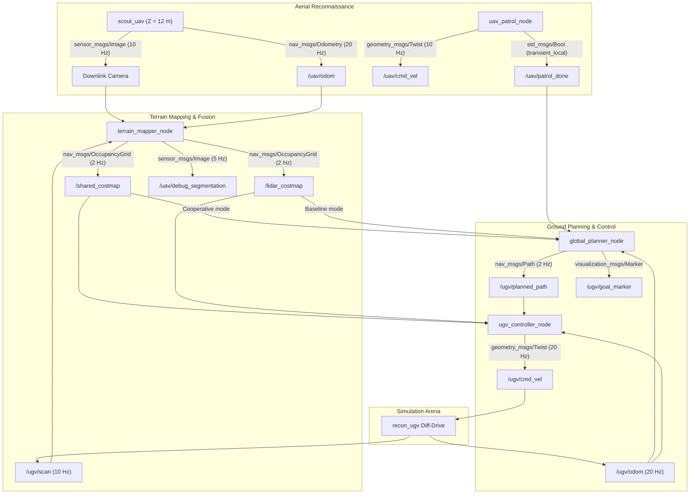

# Cooperative UAV-UGV Reconnaissance and Terrain-Aware Autonomous Navigation

Autonomous heterogeneous multi-robot system for military reconnaissance and tactical navigation in ROS 2 Humble and Gazebo Classic 11. 

A high-altitude aerial scout (`scout_uav`) surveys an unknown 30 m × 30 m hostile sector from 12 m altitude, semantically classifies terrain hazards in real time via pinhole projection, and synthesizes a global costmap. A ground rover (`recon_ugv`) leverages this aerial intelligence to plan and navigate safely around lethal minefields and mud detours along a paved road corridor at high speed, compared against a baseline terrain-blind rover that navigates directly across lethal hazards.

---

## Key Results: Cooperative vs. Baseline

Over 3 cold-start benchmark trials per mode, the cooperative system demonstrated significant improvements in safety and mission completion speed:

| Metric | Baseline Mode (LiDAR only) | Cooperative Mode (UAV + UGV) | Improvement / Impact |
|:---|:---:|:---:|:---:|
| **Mission Elapsed Time** | **70.33 ± 0.15 s** | **36.03 ± 0.64 s** | **48.8% Faster (~2× speedup)** |
| **Lethal Mine Exposure** | **16.17 ± 0.38 s** | **0.00 ± 0.00 s** | **100% Hazard Avoidance (Zero exposure)** |
| **Mud Exposure** | 0.00 ± 0.00 s | 0.00 ± 0.00 s | 0.00 s (Corridor clean) |
| **Road Utilization Time** | 7.27 ± 0.12 s | 33.35 ± 0.55 s | High-speed paved road exploitation |
| **Path Trajectory Length** | 34.71 ± 0.02 m | 44.10 ± 0.17 m | +9.4 m road detour to bypass hazards |
| **Survival / Mission Status** | **Lethal Minefield Penetration** | **Mission Accomplished Without Hazard** | Tactical Mission Success |

Despite following a route that is **9.4 meters longer**, the cooperative rover completes the mission in **nearly half the time** by exploiting the terrain speed governor on paved road (1.33 m/s on road vs. 0.50 m/s on rough dirt).

---

## System Architecture



---

## Core Technical Highlights

### 1. Aerial Downward Pinhole Projection & Segmentation
- **Camera Geometry:** Focal length $f_x = f_y = 554.26$, principal point $(c_x, c_y) = (320, 240)$, altitude $Z = 12.0\text{ m}$.
- **Ground Coordinates Calculation:**
  $$\begin{aligned}
  dx_{\text{body}} &= -(v - c_y) \cdot \frac{Z}{f_y}, \quad dy_{\text{body}} = -(u - c_x) \cdot \frac{Z}{f_x} \\
  X_w &= X_{\text{uav}} + dx_{\text{body}}\cos\theta - dy_{\text{body}}\sin\theta \\
  Y_w &= Y_{\text{uav}} + dx_{\text{body}}\sin\theta + dy_{\text{body}}\cos\theta
  \end{aligned}$$
- **HSV Semantic Classification:**
  - **Mines (Red, Cost 100):** $H \in [0, 10] \cup [170, 180]$, $S \in [100, 255]$, $V \in [80, 255]$ (dilated with $5\times 5$ kernel).
  - **Mud (Yellow, Cost 80):** $H \in [18, 34]$, $S \in [100, 255]$, $V \in [80, 255]$.
  - **Road Corridor (Green, Cost 5):** $H \in [35, 85]$, $S \in [80, 255]$, $V \in [50, 255]$.
  - **Neutral Dirt (Grey/Brown, Cost 30):** Default passable arena surface.

### 2. Dual-Layer Costmap Architecture
- `/shared_costmap`: Aerial semantic terrain layer fused with persistent 2D LiDAR obstacle endpoints (cost 100 with inflation). Published with `transient_local` durability.
- `/lidar_costmap`: LiDAR-only obstacle layer (all unhit cells set to dirt cost 30). Used by the baseline rover to simulate a standard ground vehicle with no aerial intelligence.

### 3. Weighted 8-Connected A* Global Planner
- Computes optimal paths minimizing terrain travel cost:
  $$\mathrm{StepCost}(A, B) = \mathrm{dist}(A, B) \cdot \left(1.0 + \frac{\mathrm{Cost}(B)}{10.0}\right)$$
  - Road multiplier: $1.5\times$
  - Dirt multiplier: $4.0\times$
  - Mud multiplier: $9.0\times$
  - Hazard threshold ($\ge 95$): Impassable
- Prevents diagonal corner cutting across obstacle boundaries.
- Start-cell immunity radius ($r = 3$) prevents the rover from being trapped if starting adjacent to an obstacle boundary.
- Start gate synchronized with `/uav/patrol_done`.

### 4. Terrain-Aware Regulated Pure Pursuit Controller
- **Terrain Speed Governor:**
  $$v_{\text{terrain}} = \max\left(0.15, \frac{v_0}{1.0 + \frac{\max(c)}{10.0}}\right), \quad v_0 = 2.0\text{ m/s}$$
  Evaluates maximum cost $c$ up to $1.5\text{ m}$ ahead along the path to anticipate terrain transitions (decelerates before rough terrain or mud).
- **Curvature Regulation:** $v_{\text{curv}} = v_{\text{terrain}} \cdot \max(0.25, \cos\alpha)$.
- **Rotate-to-Heading:** If heading error $|\alpha| > 0.6\text{ rad}$, linear velocity is zeroed while the rover rotates in place to prevent lateral drift.
- **Velocity Smoother:** Acceleration capped at $1.0\text{ m/s}^2$, deceleration capped at $2.0\text{ m/s}^2$ to avoid wheel slip in simulation.

---

## Repository Structure

```
uav_ugv_ws/
├── run_baseline.sh                  # One-click script for baseline mission
├── run_cooperative.sh               # One-click script for cooperative mission
├── tools/
│   ├── check_costmap.py             # Verifies costmap generation and cell counts
│   ├── check_path.py                # Verifies planned path length and road/hazard ratios
│   └── run_benchmark.py             # Runs 3-trial benchmark across both modes
└── src/
    └── tactical_recon/
        ├── package.xml
        ├── setup.py
        ├── launch/
        │   └── sim_mission.launch.py        # Master launch file
        ├── worlds/
        │   └── military_sector.world        # Self-contained Gazebo arena
        ├── urdf/
        │   ├── scout_uav.urdf               # Quadrotor scout with down-camera
        │   └── recon_ugv.urdf               # Differential-drive rover with LiDAR
        ├── rviz/
        │   └── mission_view.rviz            # Mission dashboard configuration
        └── tactical_recon/
            ├── uav_patrol_node.py           # UAV waypoint trajectory patrol
            ├── terrain_mapper_node.py       # Pinhole projection, HSV, & costmap fusion
            ├── global_planner_node.py       # Weighted A* global planner & goal marker
            └── ugv_controller_node.py       # Regulated pure pursuit & D12 metrics
```

---

## Prerequisites & Installation

### Requirements
- Ubuntu 22.04 LTS
- ROS 2 Humble Hawksbill
- Gazebo Classic 11 (`gazebo_ros_pkgs`)
- Python 3 with `numpy`, `opencv-python`, and `cv_bridge`

### Setup Workspace

```bash
# 1. Source ROS 2 Humble
source /opt/ros/humble/setup.bash

# 2. Clone or navigate to the workspace
cd ~/College/Robotics/uav_ugv_ws

# 3. Install ROS dependencies (if needed)
sudo apt update
sudo apt install -y \
  ros-humble-gazebo-ros-pkgs \
  ros-humble-cv-bridge \
  ros-humble-visualization-msgs \
  ros-humble-rviz2 \
  python3-numpy \
  python3-opencv

# 4. Build the workspace
colcon build --symlink-install

# 5. Source the workspace overlay
source install/setup.bash
```

---

## How to Run

### Option 1: Quick Launch Scripts (Recommended)

#### Run Cooperative Mission (UAV + UGV)
```bash
./run_cooperative.sh
```

#### Run Baseline Mission (Ground LiDAR Only)
```bash
./run_baseline.sh
```

*(Pass `gui:=false` to run headless without Gazebo and RViz GUI windows, e.g. `./run_cooperative.sh gui:=false`)*

---

### Option 2: Standard ROS 2 Launch

```bash
# Sourcing environment
source /opt/ros/humble/setup.bash
source install/setup.bash

# Cooperative Mission:
ros2 launch tactical_recon sim_mission.launch.py cooperative_mode:=true

# Baseline Mission:
ros2 launch tactical_recon sim_mission.launch.py cooperative_mode:=false
```

#### Available Launch Arguments:
- `cooperative_mode`: `true` (default) for cooperative UAV-UGV reconnaissance, `false` for baseline mode.
- `gui`: `true` (default) to launch Gazebo client and RViz2, `false` for headless operation.

---

### Option 3: Automated Benchmark Runner

To run 3 trials of each mode sequentially and print the statistical comparison table:

```bash
python3 tools/run_benchmark.py
```

---

### Option 4: Verification Utilities

To verify the costmap or planned path while the simulation is running:

```bash
# Check costmap cell counts (road, mine, mud, unknown):
python3 tools/check_costmap.py

# Check planned path length and hazard intersections:
python3 tools/check_path.py
```

---

## RViz2 Visualization Dashboard

When running with GUI enabled, RViz displays:
1. **Shared Costmap (`/shared_costmap`):** Rendered with `costmap` palette showing green road corridor (blue/green), yellow mud, red mine patches (purple/red), and dark obstacle inflations.
2. **Debug Segmentation (`/uav/debug_segmentation`):** Real-time 640×480 downward camera HUD showing classified 8×8 blocks with UAV position and live cell counts.
3. **Planned Path (`/ugv/planned_path`):** Cyan trajectory computed by the global planner.
4. **Goal Marker (`/ugv/goal_marker`):** Bright cylinder indicator at target coordinates $(12.0, 12.0)$.
5. **LiDAR Point Cloud (`/ugv/scan`):** Real-time 2D laser scan readings from the UGV.
6. **Robot TF Frames:** Complete transform tree for both `scout_uav` and `recon_ugv`.

---

## Mission Report Output (D12 Standard)

Upon arriving within $0.5\text{ m}$ of the goal at $(12.0, 12.0)$, the controller automatically outputs the standardized mission metrics line:

```text
[ugv_controller_node]: MISSION REPORT: elapsed_s=36.03 distance_m=44.10 mine_time_s=0.00 mud_time_s=0.00 road_time_s=33.35
```

- `elapsed_s`: Time elapsed from first wheel motion to goal arrival.
- `distance_m`: Cumulative odometry distance traveled.
- `mine_time_s`: Duration spent traversing lethal mine zones (cells with cost $\ge 95$).
- `mud_time_s`: Duration spent traversing mud patches (cost 80).
- `road_time_s`: Duration spent traversing high-speed road corridor (cost 5).
